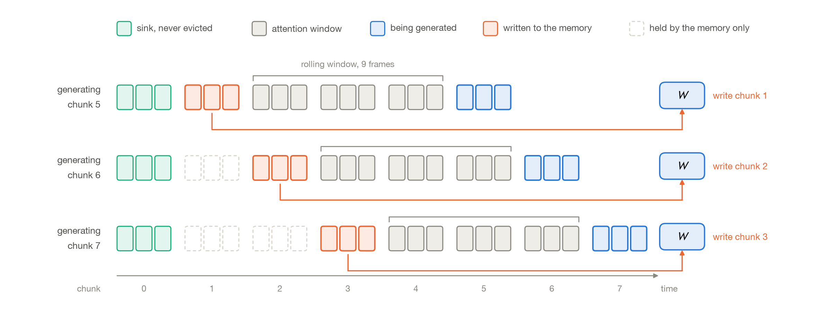
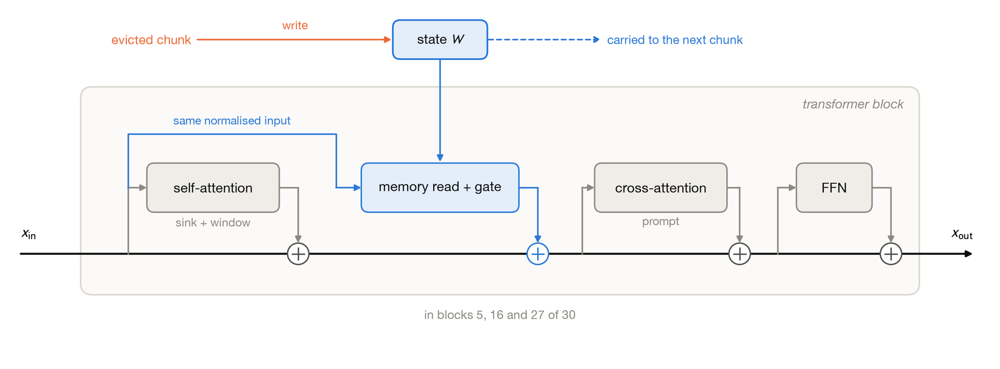

# Fast-weight memory for long-form video generation

A research fork of [Anchor-Forcing](https://github.com/vivoCameraResearch/Anchor-Forcing)
(Wan2.1-T2V-1.3B, causal streaming, DMD distillation) that adds a fast-weight memory to the
backbone, to fight identity drift over minutes of generated video.

The result is negative: [the memory does not help](#result). What this work adds to upstream is
listed in [Where the code is](#where-the-code-is), and [its tests run without a GPU](#running-it).
Upstream's README is kept at [`UPSTREAM_README.md`](UPSTREAM_README.md).

## The problem

The model generates 3 latent frames at a time and attends to 12 frames: 3 pinned sink frames
and a rolling window of 9. Everything older is evicted. Identity is long-range information, so once
the subject established at second 0 leaves the window, only the prompt constrains it, and the
prompt gives a category ("a woman in a red coat"), never the instance. Those attributes drift.

## How it works

A memory branch is inserted in a few transformer blocks (layers 5, 16, 27 of 30). Each branch
carries a fast weight `W` that is rewritten during generation, by the forward pass, not by the
optimizer.

What the memory is fed. Attention sees the sink and a rolling window; the chunk that has just
left the window is the one the memory writes.



Where it sits. The branch reads the same normalised input as self-attention and adds a gated
output to the residual stream; its state lives outside the block and is carried across chunks.



What the cell does, for the chunk generated at step $t$: $q$ comes from that chunk, $k$ and
$v$ from the tokens of the chunk that has just left the window, and $`W = (w_0, w_1, w_2)`$.

```math
\begin{aligned}
\textbf{read}\quad & o_t = f_{W_{t-1}}(q_t), \qquad f_W(x) = \big(\mathrm{SiLU}(x\,w_0)\odot x\,w_2\big)\,w_1 \\
\textbf{write}\quad & G = \nabla_W \sum_i \eta_i\,\langle f_W(k_i),\, v_i\rangle \\
& \widetilde{W} = W_{t-1} + \mathrm{Muon}(G) \\
& W_t[:,j] = \widetilde{W}[:,j]\,\frac{\lVert W_0[:,j]\rVert}{\lVert \widetilde{W}[:,j]\rVert} \\
\textbf{inject}\quad & x \leftarrow x + g(x)\odot \mathrm{AdaLN}\big(\mathrm{norm}(o_t)\big)
\end{aligned}
```

The read uses the state from before this step's write. $`\eta_i`$ is a learning rate per token
and per matrix, predicted from the token; Muon is five Newton-Schulz iterations; $g$ is the
bounded gate. With `use_decay` the state is first scaled by a learned forget gate, and the last
line caps each column at its initial norm instead of restoring it.

Three points are not obvious from the code:

- The write is fed the evicted chunk, not the current one. Writing the current chunk would
  duplicate what attention already has; the memory is only useful for what has left the window.
- The write is a forward-pass update: one gradient-ascent step on an inner score, then
  Newton-Schulz orthogonalization (Muon) and a per-column renormalization back to the initial
  norms. The state can rotate but cannot grow.
- The output gate is bounded and content-dependent, so the branch can stay silent when the
  state holds nothing relevant. The failure mode of an unbounded gate is a constant-magnitude
  vector added to every frame, which reads as "the memory is toxic" and is really an artifact.

| tensor | shape | lives in |
|---|---|---|
| fast weight `w0`, `w2` | `(1, 1536, 6144)` | `TTTBlockCache.state`, carried across chunks |
| fast weight `w1` | `(1, 6144, 1536)` | same |
| KV cache per layer | `(1, 18720, 12, 128)` | rolling, overwritten in place |
| one chunk of queries | `(1, 4680, 1536)` | 3 frames × 1560 tokens |

Training compares each chunk against a counterfactual twin of itself: the same chunk
regenerated with the memory switched off, sharing history, KV cache and noise, so the only
difference between the two is the injection. `model/twin_objective.py` builds that twin and
scores four terms against it. Identity may not get worse, motion must match, and the injection
must be measurably non-zero. All four terms are weighted zero in the runs reported below, which
are plain DMD; the twin is there to be read, not to explain the figure.

## Result


- The memory does not help: with it active, identity is lower than with it zeroed at 10 of the
  15 checkpoints, by 0.07 on average.
- Training costs motion, memory or not: in runs 1 to 3 both arms fall under the motion reference.
- One lead is open: a training-free delta write rule reads the subject out of the state where
  the deployed rule does not.

One column per training run, identity on top, motion below, against the training step. The
dashed line is that run's own unmodified model. The four share everything except what their
titles name: same frozen backbone, same LoRA co-training, and the same objective, plain DMD
distillation with every extra loss term in the codebase weighted zero. Run 4 differs from run 3
by one line of config, the fine-tune it starts from, which is why its reference sits lower. Six
prompts per point, one seed, no repeat, so there is no noise estimate. One point per step; EMA
and 480-frame evaluations are left out, and where a step was evaluated at two sink sizes the
sink-1 measurement is the one drawn.

The two arms of a panel are always comparable. The dashed line is not, in panels 2 to 4: the
reference was generated once, with 3 sink frames, while those arms were evaluated with 1. Run 1
has both measurements at step 1250, and going from sink 3 to sink 1 costs 0.06 to 0.09 of
identity, the size of the effects below. So the conclusions rest on memory active against memory
zeroed; against the reference, only run 1 is a fair comparison.

The motion cost belongs to the continued training and not to the memory, since the
memory-zeroed arm pays it too. Where motion does come back, run 2 at step 1250, identity with the memory active has
collapsed to 0.36. In run 1, the one fair comparison to the reference, the only arm that ends
above it on identity is the memory-zeroed one (0.773 against 0.743), with a third fewer clips
rated dynamic; with the memory active identity is 0.667 and dynamic degree 0.23, a near-frozen
video. Run 4 keeps more motion than its reference, and the memory still lowers identity there at
two checkpoints out of three.

The likely reason, for this write rule, this objective and this backbone, which is all that
was tested: chunk-local DMD and the usual metrics reward the same thing, temporal
self-similarity, so a learnable memory converges to a freeze or to a constant-bias degeneracy
that the dashboard scores as healthy. The frozen checkpoints show it: run 1 at step 1250 and
run 2 at step 750 have a dynamic degree of 0.23 and 0.24, and VBench rates their subject
consistency at 0.97 and 0.98, above the unmodified model's 0.95.

A second line of work, in `pipeline/switch/`, tests recall directly. The prompt switches from
subject A to B and back to A, and at the return the model is handed an anchor: one latent frame
of A's first appearance, real or decoded from the memory state. Controls matter here: an anchor
taken from a different video helps as much as the right one, which is how the apparent gain
turned out never to have been content-driven.

The open lead in numbers: median 13.5/19 for the delta rule against 7.0 for the deployed one, over
10 seeds, with a background control at chance. The score counts, out of 19 video pairs with a
clearly distinct subject, how many the state tells apart in a two-way choice, so chance is 9.5; it
is read offline from replayed states (`write_only` and `replay_writes` in
`wan/modules/video_memory.py` are that replay's interface). The two distributions barely overlap (11
to 16 against 6 to 10), but the delta rule's median sits just under the 14/19 a single seed needs to
be significant. The probe scripts ran on the training cluster and are not in this repository, so
these numbers cannot be reproduced from here.

## Running it

Without a GPU and without weights, the checks that need no torch run in seconds:

```bash
pip install -r requirements-dev.txt
python -m pytest                       # without torch, the four files below; with it, all of tests/
python tests/test_env_and_schedule.py  # arm switches and prompt schedule
python tests/test_imports.py           # every module imports, heavy packages stubbed
python tests/test_eval_report.py       # the scoring script writes the 29 published tables again
python tests/test_readme_claims.py     # the numbers and the config claims of this README
python -m utils.env                    # the switches of the measurement arms, one line each
```

With torch, `tests/test_memory_cell.py` checks what this README says of the cell through the code
the model calls: a zero gate is exactly inert, the read sees the state from before the write, the
write takes the evicted chunk and keeps the column norms, and an offline replay rebuilds the same
state. `tests/test_inference_smoke.py` streams a miniature model with the memory live, and
`tests/fingerprints.py` hashes the memory path to tell a refactor from a behaviour change.

With the weights:

```bash
python scripts/download_weights.py                    # Wan2.1-T2V-1.3B + Anchor-Forcing checkpoints, ~26 GB
python scripts/encode_prompts.py --file ckpt/prompts/bench/vbench_all_dimension_extended.txt --limit 1
AF_LAZY_TEXT_ENCODER=1 PYTHONPATH=. python inference/inference.py --config_path configs/inference.yaml
```

That config runs the unmodified model. The four training runs behind the figure have their
configs under `configs/runs/` and their measurements under `results/`, whose README gives the
evaluation protocol and says what is comparable to what.

Two passes because the text encoder (11.4 GB) and the generator do not fit in memory together on
a consumer machine: pass 1 encodes and exits, pass 2 never loads the encoder. Training needs
CUDA and two 48 GB cards.

What has and has not been run since the code was reorganised into its own modules: the memory
cell, the model and the inference rollouts give bit-identical numbers before and after, with
the real weights. The training path (`trainer/memory_training.py`, `model/twin_objective.py`)
was moved the same way and read side by side against the previous code, but not executed
since, for lack of a CUDA machine. The training code as it stood before is at the git tag
`before-refactor`; run a few steps of both and compare the loss before trusting a new run.

Runs on CUDA, Apple Metal and CPU. On CUDA every device call delegates to the original
`torch.cuda` one, so no previously measured number moves. `tests/test_device.py` checks that by
reimplementing upstream's rotary embedding and demanding bitwise equality.

## Where the code is

Upstream's files are kept recognisable: what this work adds lives in files of its own, mixed
into upstream's classes, so `git diff 392b3f8` on an upstream file shows call sites and little else.

| file | what it holds |
|---|---|
| `wan/modules/video_memory.py` | the memory cell: read, write gradient, Muon update, gated output |
| `wan/modules/memory_inject.py` | the cell inside a transformer block, and the eviction feed |
| `model/twin_objective.py` | the counterfactual-twin objective |
| `trainer/memory_training.py` | backpropagation across chunks, state snapshots, optimizer groups, memory logs |
| `pipeline/memory_rollout.py` | the write pass under grad, and cache dropout |
| `pipeline/switch/` | recall at a prompt switch: `driver.py` is the rollout, `schedule.py` its plan, `replay.py` and `decoded_anchor.py` the two ways of bringing the subject back, `anchor_controls.py` the controls on what they carry |
| `utils/device.py`, `utils/env.py`, `utils/prompt_cache.py` | device layer, arm switches, prompt cache |

## Credit

The base import (`392b3f8`) is an unmodified copy of upstream `vivoCameraResearch/Anchor-Forcing`.
The backbone, the DMD distillation and the streaming pipeline are theirs. Everything after that
commit is this work: the memory cell, its write rules, the training objectives and the
evaluation code. License CC BY-NC-SA 4.0, inherited from upstream; see [`LICENSE`](LICENSE).
