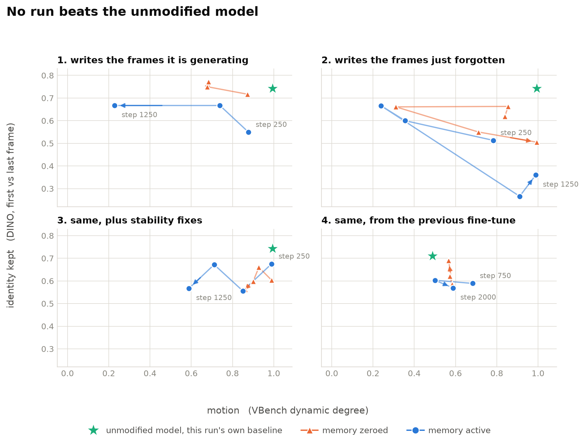

# Fast-weight memory for long-form video generation

A research fork of [Anchor-Forcing](https://github.com/vivoCameraResearch/Anchor-Forcing)
(Wan2.1-T2V-1.3B, causal streaming, DMD distillation) that adds a **fast-weight memory** to the
backbone, to fight identity drift over minutes of generated video.

Upstream's README is kept at [`reference/UPSTREAM_README.md`](reference/UPSTREAM_README.md).

## The problem

The model generates 3 latent frames at a time and attends to a rolling window of 12 frames plus
3 pinned sink frames. Everything older is evicted. Identity is long-range information, so once
the subject established at second 0 leaves the window, only the prompt constrains it — and the
prompt gives a category ("a woman in a red coat"), never the instance. Those attributes drift.

## How it works

A memory branch is inserted in a few transformer blocks (layers 5, 16, 27 of 30). Each branch
carries a **fast weight** `W` that is rewritten during generation, by the forward pass, not by
the optimizer.

```
chunk t                    chunk t+1
   │                          │
   ▼                          ▼
┌────────────────────────────────────────┐
│  KV cache   [ sink ×3 | window ×12 ]   │  FIFO, oldest chunk evicted
└────────────────────────────────────────┘
                 │ evicted chunk  (what attention can no longer see)
                 ▼
        ┌──────────────────┐
        │   memory cell    │   read   o = f_W(q)          q from the current chunk
        │   fast weight W  │   write  W ← renorm(Muon(∇_W ⟨f_W(k), v⟩))
        └──────────────────┘   inject x ← x + gate(x)·AdaLN(o)   into the residual stream
```

Three points are not obvious from the code:

- **The write is fed the evicted chunk**, not the current one. Writing the current chunk would
  duplicate what attention already has; the memory is only useful for what has left the window.
- **The write is a forward-pass update**, one gradient-ascent step on an inner score, then
  Newton–Schulz orthogonalization (Muon) and a per-column renormalization back to the initial
  norms. The state can rotate but cannot grow.
- **The output gate is bounded and content-dependent**, so the branch can stay silent when the
  state holds nothing relevant — the failure mode of an unbounded gate is a constant-magnitude
  vector added to every frame, which reads as "the memory is toxic" and is really an artifact.

| tensor | shape | lives in |
|---|---|---|
| fast weight `w0`, `w2` | `(1, 1536, 6144)` | `TTTBlockCache.state`, carried across chunks |
| fast weight `w1` | `(1, 6144, 1536)` | same |
| KV cache per layer | `(1, 18720, 12, 128)` | rolling, overwritten in place |
| one chunk of queries | `(1, 4680, 1536)` | 3 frames × 1560 tokens |

Training compares each chunk against a **counterfactual twin of itself**: the same chunk
regenerated with the memory switched off, sharing history, KV cache and noise, so the only
difference between the two is the injection. `model/streaming_training.py` builds that twin and
scores four terms against it — identity may not get worse, motion must match, and the injection
must be measurably non-zero.

## Result



The memory does not beat attention plus sink. Worse, the training itself costs motion: every
trained arm sits left of the unmodified model, and switching the memory on does not buy identity
back. The one point that looks like a win, top centre, is a checkpoint with a third less motion.

The reason generalises. The training objective (chunk-local DMD) and the usual metrics reward
the same thing — temporal self-similarity — so a learnable memory converges to a freeze or a
constant-bias degeneracy that the dashboard scores as healthy. The leftmost points above are
frozen videos, and VBench still rates their subject consistency at 0.93.

Controls matter here: an anchor decoded from a **different video** helps as much as the right
one, which is how we found that the apparent gain was never content-driven.

One lead is still open: a training-free **delta write rule** reads the subject out of the state
where the deployed rule does not (median 13.5/19 vs 7.0 over 10 seeds, with a background control
at chance).

## Running it

```bash
python download_weights.py                    # Wan2.1-T2V-1.3B + Anchor-Forcing checkpoints, ~26 GB
python encode_prompts.py --file ckpt/prompts/bench/vbench_all_dimension_extended.txt --limit 1
AF_LAZY_TEXT_ENCODER=1 PYTHONPATH=. python inference/inference.py --config_path configs/inference.yaml
```

That config runs the **unmodified** model. The memory arms carry their own configs under
`reference/runs/`; always declare `memory_layers` explicitly, because the model default is a
memory branch whose weights are in no checkpoint.

Two passes because the text encoder (11.4 GB) and the generator do not fit in memory together on
a consumer machine: pass 1 encodes and exits, pass 2 never loads the encoder. Training needs
CUDA and two 48 GB cards.

Runs on CUDA, Apple Metal and CPU. On CUDA every device call delegates to the original
`torch.cuda` one, so no previously measured number moves — `tests/test_device.py` checks that by
reimplementing the pre-patch rotary embedding and demanding bitwise equality.

```bash
python tests/test_device.py            # device layer
python tests/test_inference_smoke.py   # real model, streaming, no weights needed
```

## Credit

The base import (`392b3f8`) is byte-identical to upstream `vivoCameraResearch/Anchor-Forcing`.
The backbone, the DMD distillation and the streaming pipeline are theirs. Everything after that
commit — the memory cell, its write rules, the training objectives and the evaluation code — is
this work. License CC BY-NC-SA 4.0, inherited from upstream.
